# Documentación de Ejecución - Proyecto Hibernate (Pokédex)

Este documento detalla paso a paso el flujo de ejecución del método `main`, mostrando las llamadas realizadas, la lógica interna de los servicios y los resultados obtenidos por consola.

## Índice
1. [Inserción de datos iniciales (Create)](#1-inserción-de-datos-iniciales-create)
    - [1.1. Insertar 10 Pokémon en la Pokédex](#11-insertar-10-pokémon-en-la-pokédex)
    - [1.2. Insertar 2 Adiestradores](#12-insertar-2-adiestradores)
    - [1.3. Insertar 12 Pokémon asociados a Adiestradores](#13-insertar-12-pokémon-asociados-a-adiestradores)
2. [Primer listado de datos (Read)](#2-primer-listado-de-datos-read)
    - [2.1. Listar Pokédex](#21-listar-pokédex)
    - [2.2. Listar Adiestradores](#22-listar-adiestradores)
    - [2.3. Listar Pokémon](#23-listar-pokémon)
3. [Exportación y Serialización](#3-exportación-y-serialización)
    - [3.1. Serializar entradas de la Pokédex](#31-serializar-entradas-de-la-pokédex)
    - [3.2. Exportar Adiestradores a XML](#32-exportar-adiestradores-a-xml)
4. [Modificación de registros (Update)](#4-modificación-de-registros-update)
    - [4.1. Modificar entradas de la Pokédex](#41-modificar-entradas-de-la-pokédex)
    - [4.2. Modificar Adiestradores](#42-modificar-adiestradores)
    - [4.3. Modificar Pokémon](#43-modificar-pokémon)
5. [Segundo listado tras modificaciones (Read)](#5-segundo-listado-tras-modificaciones-read)
6. [Importación y Restauración desde archivos](#6-importación-y-restauración-desde-archivos)
    - [6.1. Deserializar y restaurar Pokédex](#61-deserializar-y-restaurar-pokédex)
    - [6.2. Importar y restaurar Adiestradores desde XML](#62-importar-y-restaurar-adiestradores-desde-xml)
7. [Listado final tras restauración (Read)](#7-listado-final-tras-restauración-read)
8. [Eliminación de todos los datos (Delete)](#8-eliminación-de-todos-los-datos-delete)

---

## 1. Inserción de datos iniciales (Create)

### 1.1. Insertar 10 Pokémon en la Pokédex
* **Código en `main`:**
  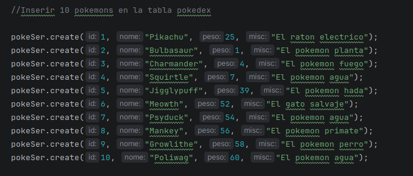
* **Método ejecutado (`PokedexService.create`):**
   de la clase Pokedex)*
* 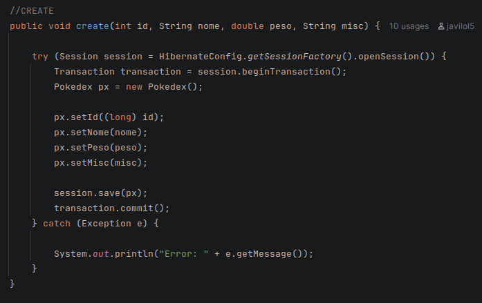

### 1.2. Insertar 2 Adiestradores
* **Código en `main`:**
  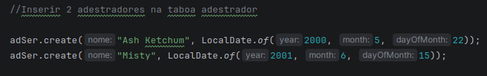
* **Método ejecutado (`AdestradorService.create`):**
  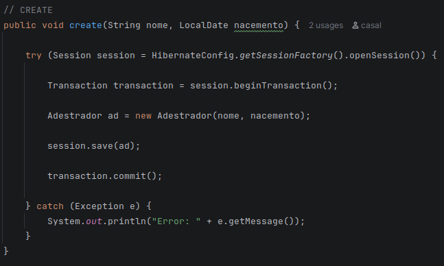

### 1.3. Insertar 12 Pokémon asociados a Adiestradores
* **Código en `main`:**
  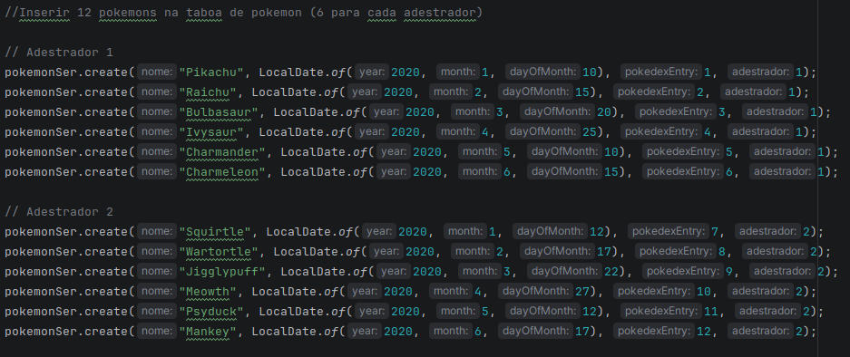
* **Método ejecutado (`PokemonService.create`):**
  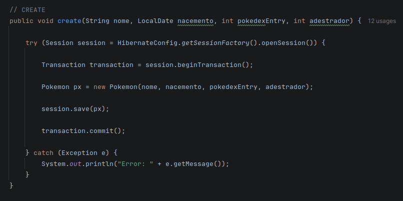

---

## 2. Primer listado de datos (Read)

### 2.1. Listar Pokédex
* **Código en `main`:**

  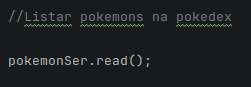
* **Método ejecutado (`PokedexService.read`):**
  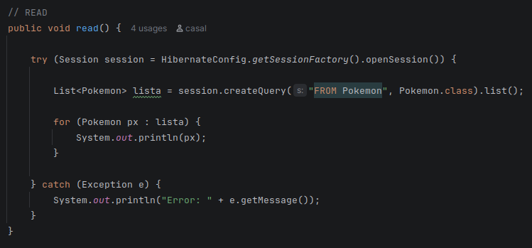
* **Resultado por terminal:**
  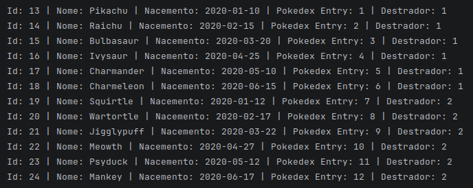

### 2.2. Listar Adiestradores
* **Código en `main`:**
  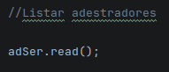
* **Método ejecutado (`AdestradorService.read`):**
  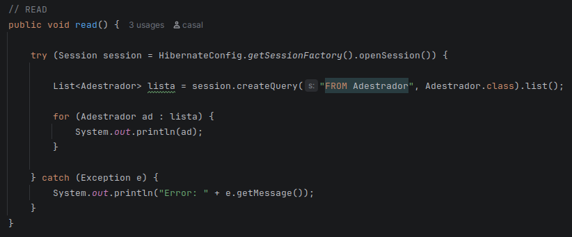
* **Resultado por terminal:**

  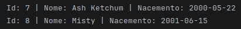

### 2.3. Listar Pokémon
* **Código en `main`:**

  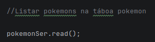
* **Método ejecutado (`PokemonService.read`):**
  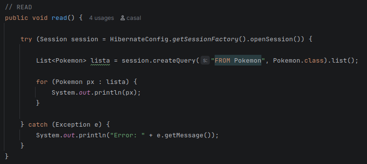
* **Resultado por terminal:**
  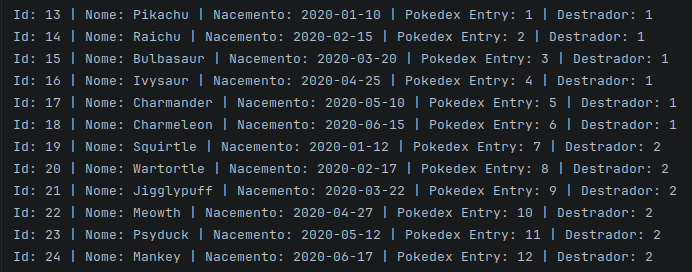

---

## 3. Exportación y Serialización

### 3.1. Serializar entradas de la Pokédex
* **Código en `main`:**

  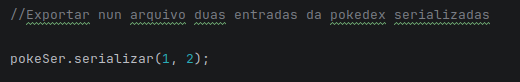
* **Método ejecutado (`PokedexService.serializar`):**
  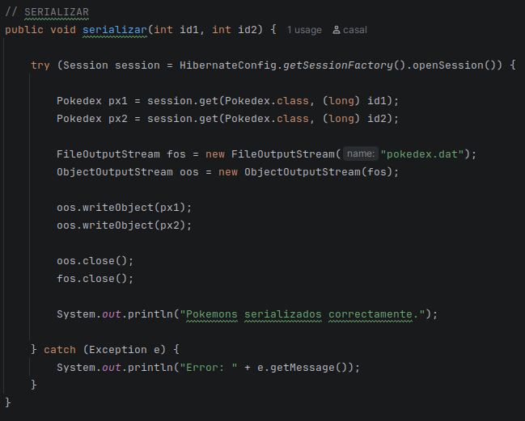
* **Resultado por terminal / Archivo generado:**
  
  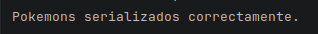

### 3.2. Exportar Adiestradores a XML
* **Código en `main`:**

  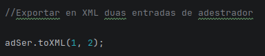
* **Método ejecutado (`AdestradorService.toXML`):**
  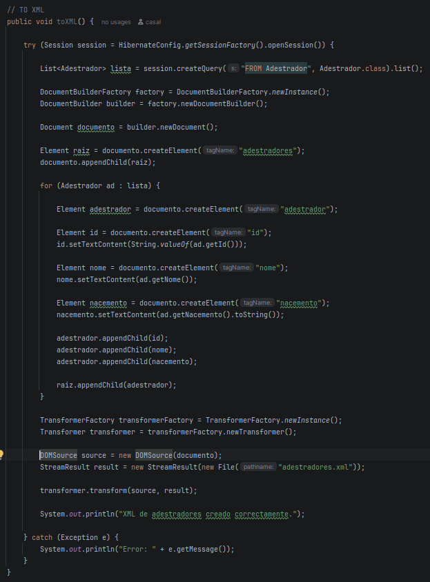
* **Resultado por terminal / Archivo XML generado:**
  
  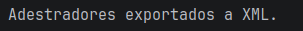

---

## 4. Modificación de registros (Update)

### 4.1. Modificar entradas de la Pokédex
* **Código en `main`:**
  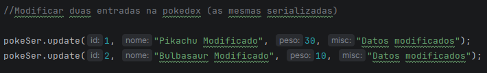
* **Método ejecutado (`PokedexService.update`):**
  
* **Resultado por terminal:**
  > *(⚠️ Falta captura de la consola)*

### 4.2. Modificar Adiestradores
* **Código en `main`:**
  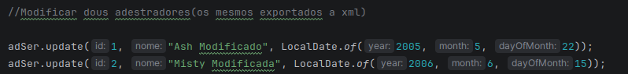
* **Método ejecutado (`AdestradorService.update`):**
  
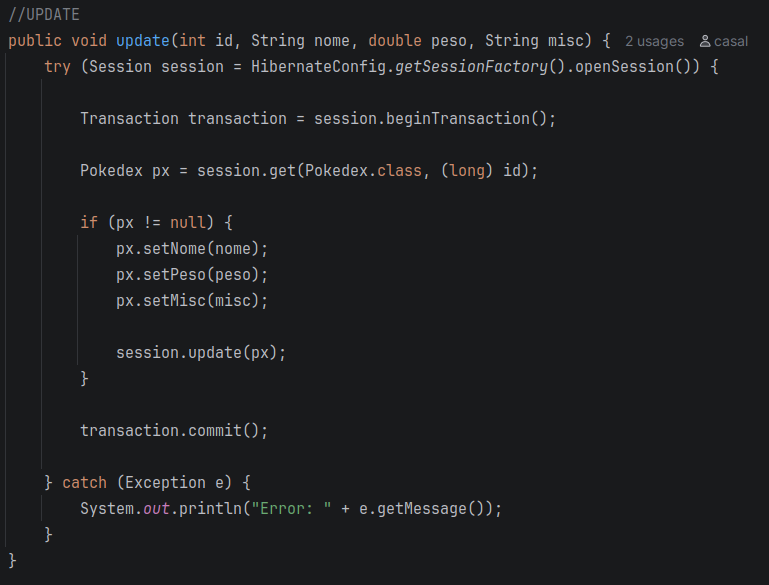

### 4.3. Modificar Pokémon
* **Código en `main`:**
  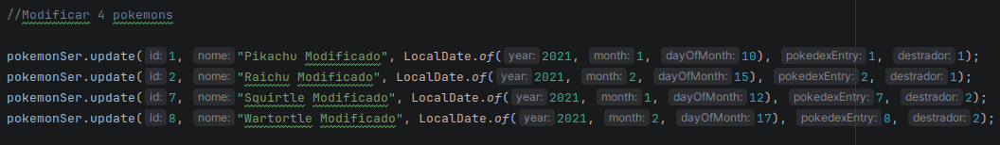
* **Método ejecutado (`PokemonService.update`):**
  
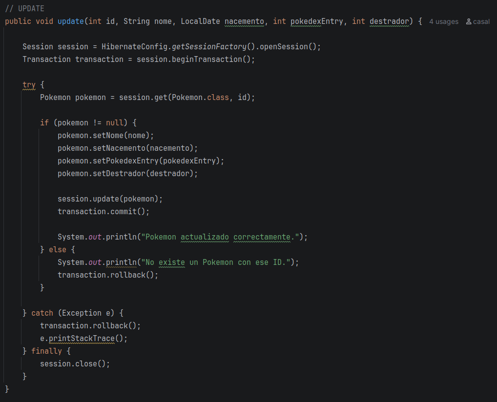

---

## 5. Segundo listado tras modificaciones (Read)
* **Código en `main`:**

  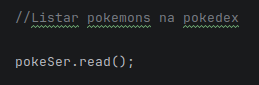

  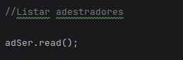

  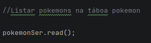
* **Métodos ejecutados:** *(Ya mostrados en el apartado 2).*
* **Resultado por terminal:**
  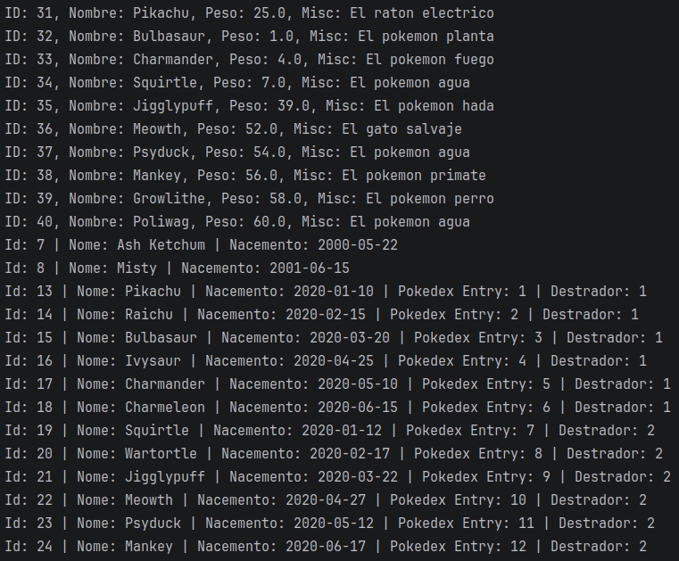

---

## 6. Importación y Restauración desde archivos

### 6.1. Deserializar y restaurar Pokédex
* **Código en `main`:**

  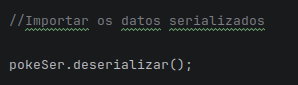

  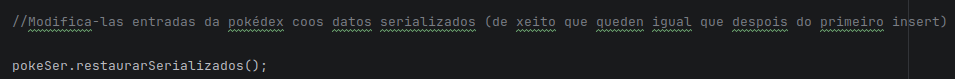
* **Métodos ejecutados (`deserializar` y `restaurarSerializados`):**
  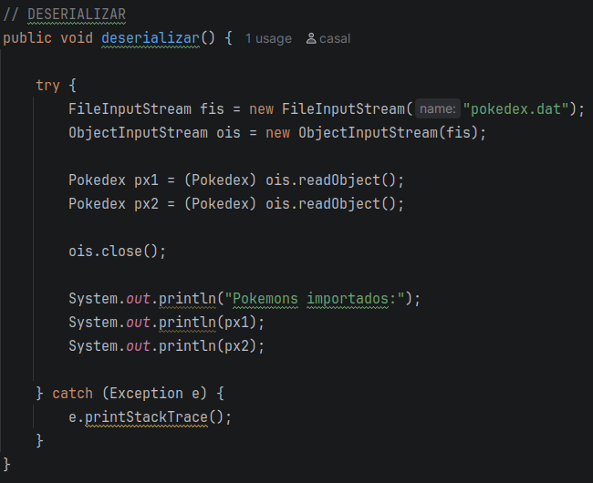
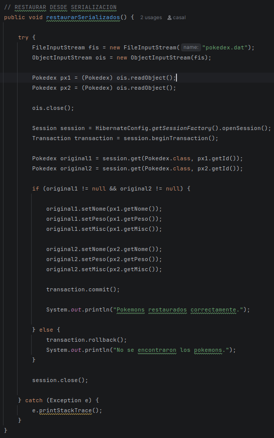

### 6.2. Importar y restaurar Adiestradores desde XML
* **Código en `main`:**

  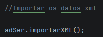

  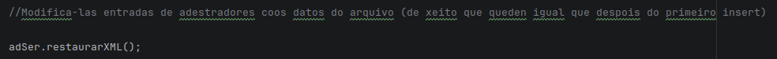
* **Métodos ejecutados (`importarXML` y `restaurarXML`):**
    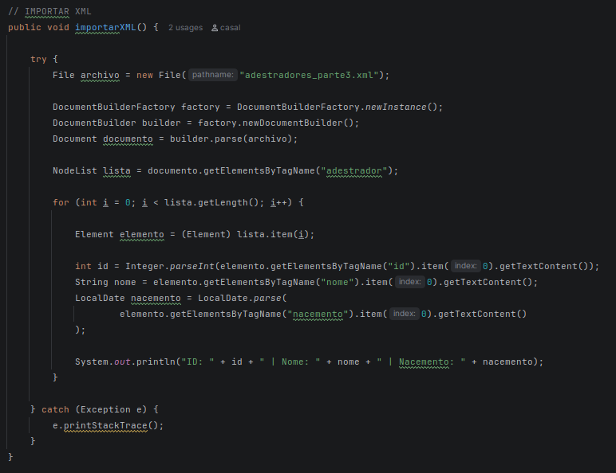
    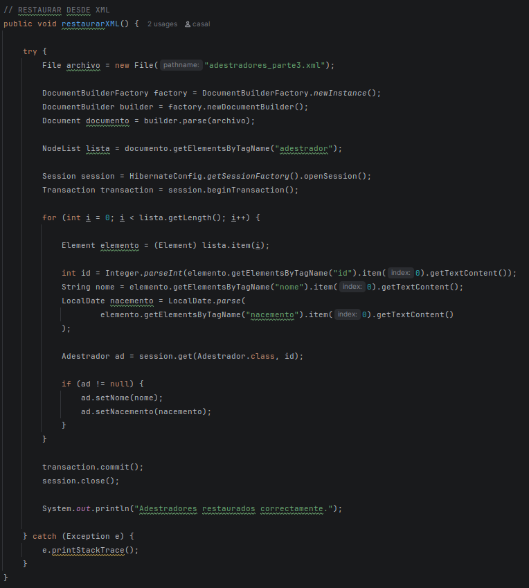

---

## 7. Listado final tras restauración (Read)
* **Código en `main`:**

  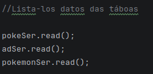
* **Resultado por terminal:**
      

---

## 8. Eliminación de todos los datos (Delete)
* **Código en `main`:**

  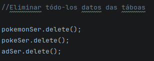
* **Métodos ejecutados (`delete` en los 3 servicios):**
  
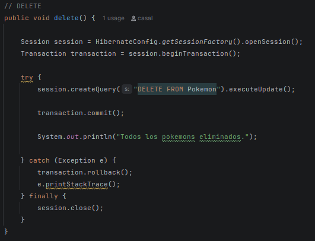
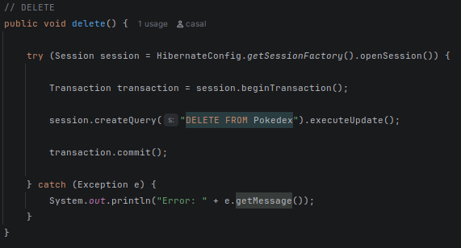
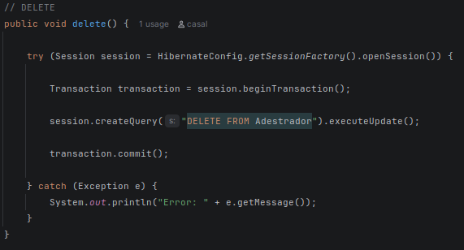
* **Resultado por terminal:**
* 
  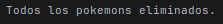